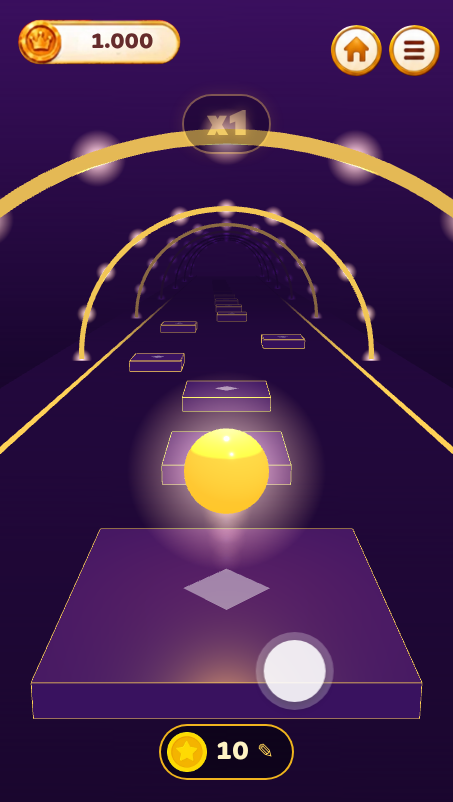
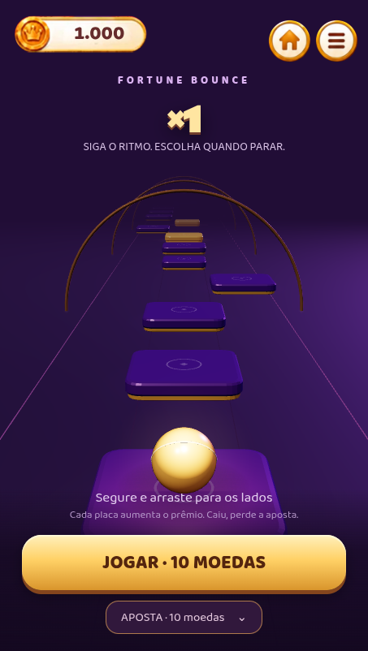

# Fortune Bounce

Jogo de habilidade com moedas virtuais. Três faixas, arrasto contínuo, +0,1 de multiplicador por placa. A primeira placa dourada garante seu valor. Não há RTP fixo: o resultado depende da trajetória e do jogador. A dificuldade está visível na pista. Na placa 500 há recebimento automático, limite explícito no menu.

O build inclui `Fortune Bounce.dc.html`, `bounce3d.js`, o modelo compartilhado `runtime/bounce-model.js` e Three.js local do lockfile. A Home aponta para o jogo. A sessão Google e o menu são os mesmos dos outros jogos.

## Persistência no Spark

`cloud/bounce.cjs` gera a pista deterministicamente pelo UUID da rodada. `cloud/store.mjs` usa transações em `players/{uid}` e operações imutáveis com UUID. Iniciar usa o ID da própria rodada: repetir a requisição não inicia outra aposta. Os movimentos são `start`, `land`, `collect`, `fall`; cada um confere rodada, aposta e passo anterior. Um passo só avança uma placa. O primeiro contato dourado fixa `guardStep`.

A rodada persistida contém `{id, betUnits, step, guardStep}`. O saldo é inteiro em centésimos. Iniciar debita uma vez; aterrissar confirma o progresso; pegar ou cair encerram e creditam uma vez. O próximo salto espera seu checkpoint. O prêmio já está no saldo quando o diálogo aparece; fechar o diálogo não movimenta moedas. Recarregar fica bloqueado durante qualquer rodada aberta.

Pedidos pendentes ficam associados ao UID e são repetidos com o mesmo identificador após uma falha ou atualização. Ao retomar, a pista fica pausada na última placa confirmada. Operações antigas podem ser consultadas novamente sem substituir uma revisão mais recente do saldo. O modo publicado não lê saldo nem progresso dos protótipos em localStorage. O modo local usa uma chave separada de prévia.

As regras validam identidade Google, propriedade, formato, sequência, valores e vínculo da operação. Como nos outros jogos deste protótipo Spark, o navegador informa a colisão e o resultado: as regras não simulam a física nem recalculam o gerador da pista. Não é uma economia com resultados autoritativos no servidor. Nenhuma Cloud Function, assinatura Blaze ou serviço pago foi acrescentado.

## Verificação

- `npm test`: pista determinística, centésimos, primeira garantia, repetição, conflito, restauração dos adaptadores e build local.
- `npm run test:integration`: Google Auth e regras Firestore emulados, navegador com gestos reais, Home, menu, aposta, prêmio, duas abas, recarga e jogos existentes. `tests/bounce_browser.py` inclui retomada da mesma pista, queda com atualização antes do fim da animação, garantia dourada e layout com movimento reduzido.
- Depois da integração: `npm run build:production`.

Decisões estéticas e referências: [fortune-bounce-feel.md](../guidelines/fortune-bounce-feel.md).

Validação em 16/out/2026: 69 casos de código (10 arquivos), 15 testes reais de regras Firestore e suíte de navegador dos seis jogos aprovados. A prévia gráfica também confirmou setas do teclado, recebimento pelo valor mostrado e contagem estável de recursos em vinte reinícios.

## Prévia visual

| Antes | Depois |
|---|---|
|  |  |

[Vídeo da prévia local](media/bounce-demo.webm), gravado no navegador com gestos automatizados para mostrar saltos, batidas e recebimento. Usa a carteira local de demonstração; as validações da carteira Google/Firestore foram executadas separadamente na suíte de integração.
